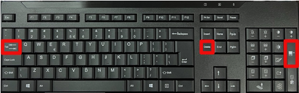
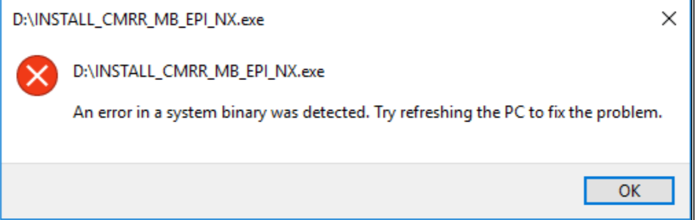
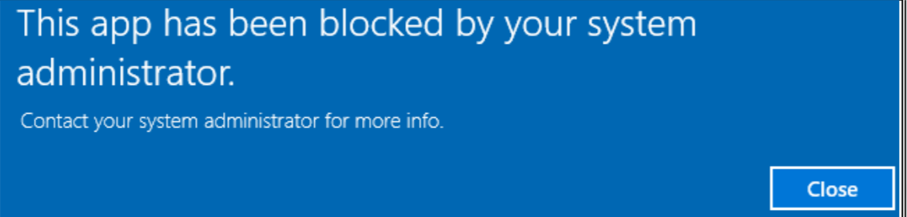
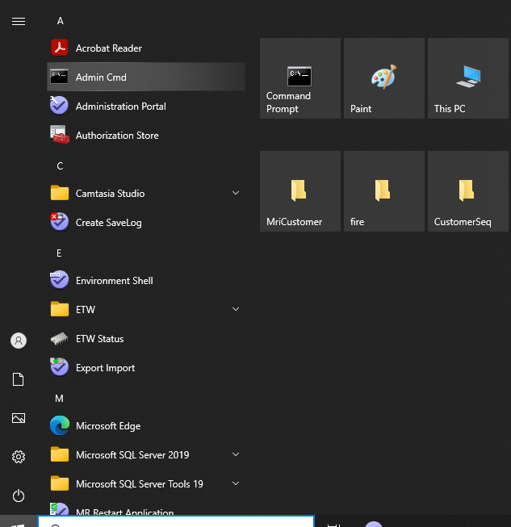

# Install Security Certificate

## 1.  Deactivate kiosk mode
1. Press `TAB-DELETE-SENDtoPACS` keys (see figure)

     
    **Figure 1.** Disable kiosk mode
1. Enter admin credentials
## 2. Check if certificate is already installed

#### Case 1: An installer is provided
1. Copy the installer on the console e.g. in `C:\temp`
1. Double-click on installer (.exe file) **Do not** try to run it as an administrator yet. This step will fail, but the error message will tell you whether the certificates are installed or not.

If this error message appears: 
 
then the certificates are not installed. Proceed to next step to install them.

If this error message appears: 
 
then the certificates are installed and you can proceed to installation by right-clicking the executable file and select `Run as administrator`

#### Case 2: No installer is provided

  1. Copy sequence files in: 
  `C:\ProgramData\Siemens\Numaris\MriCustomer\CustomerSeq`

  1. Copy reconstruction files in: 
  `C:\ProgramData\Siemens\Numaris\MriCustomer\Ice`

  1. Try to load the sequence from the DEFAULT tree - Customer Sequences region

## 3. Install certificate
  1. Copy certificate (.cer) file on disk
  1. Right-click on file and choose `Install certificate`
  1. Select `Local machine` as Store Location
  1. Enter admin Credentials
  1. Select `Place all certificates in the following store`, then click browse
  1. Select `Trusted Root Certification Authorities` and click `OK`
  1. Click `Next`
  1. Click `Finish`

## 4. Register certificates with device guard
  1. Open admin command prompt or right-click normal command prompt, then select `run as administrator` 
   
  1. Type in admin credentials
  1. Type in `powershell`
  1. Type in `Set-ExecutionPolicy Bypass`
  1. Type in `Get-ExecutionPolicy` (check that status is actually set to bypass)
  1. Type in `& $env:MED_BIN\Scripts\DeviceGuardPreparation.ps1 C:\TEMP\MyCertificateName.cer` with the path to the certificate you installed on preceding step **Important** This step may appear to hang, but can take as long as 10 minutes to complete. Do not reboot system or close window.
  1. Repeat step 6 for each certificate you need to install
  1. Restart system. Full reboot is required - not just restart workplace
