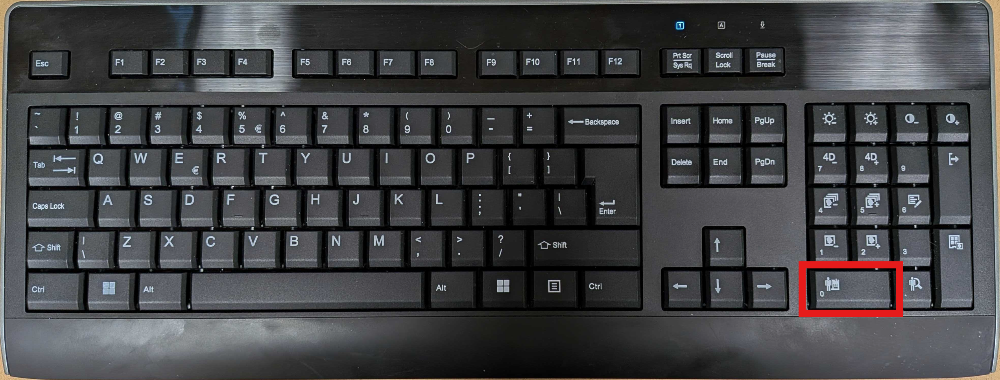
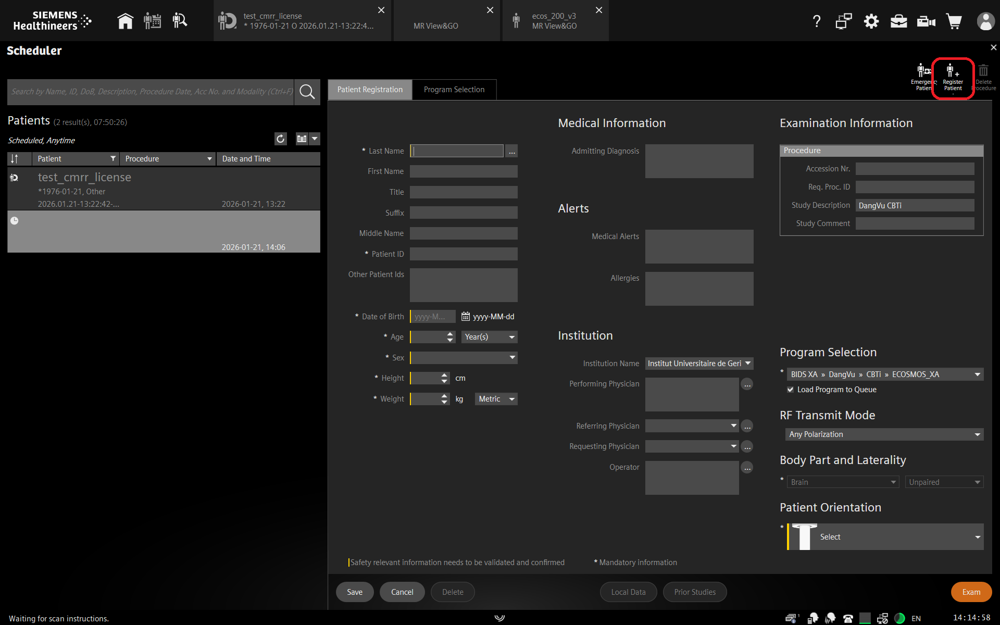
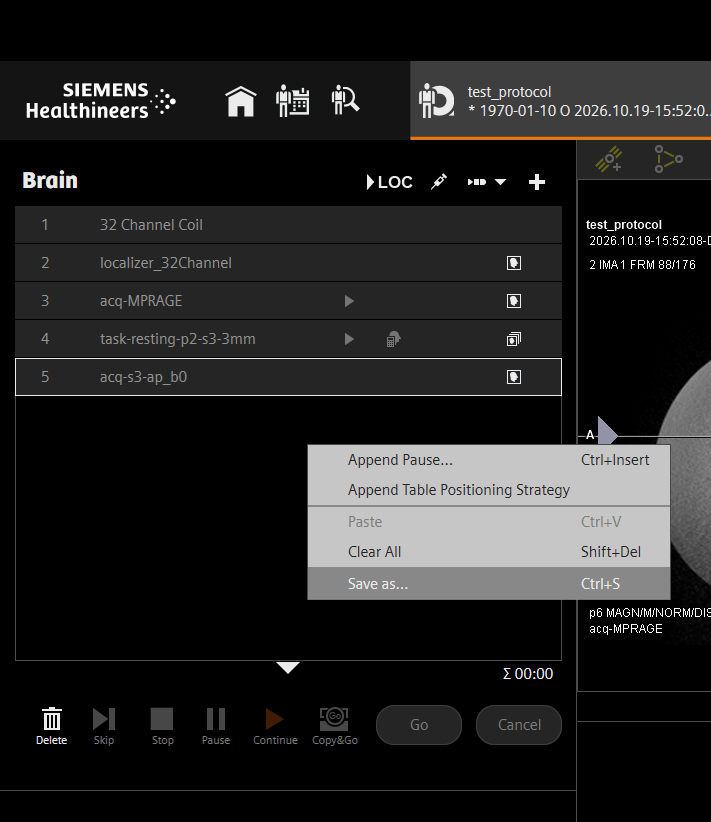
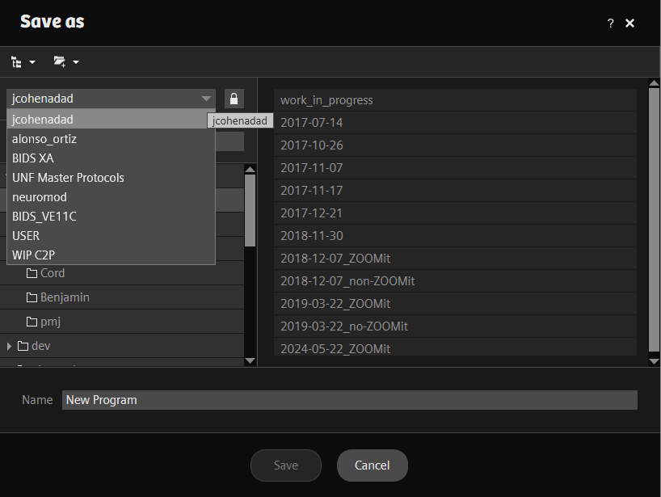
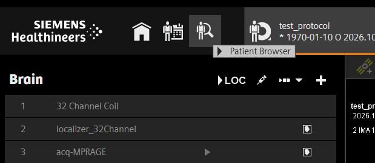
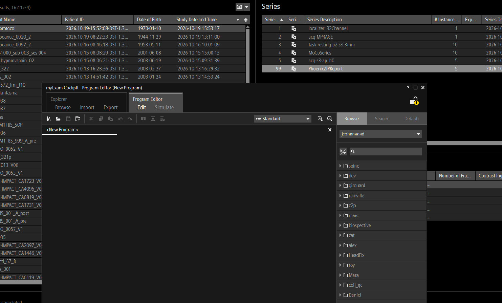
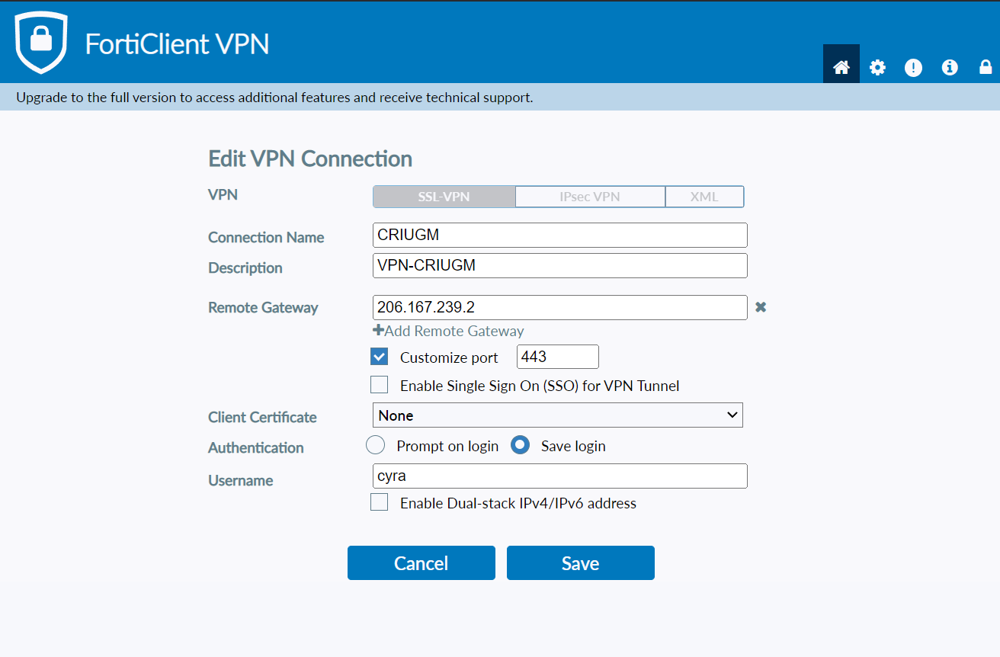
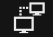
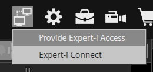

UNF 3T generic procedures

#### Authors:
Daniel Papp 
MRI Physicist 
2023

André Cyr 
Biomedical engineer 
2026

Version|Initials|Date|Comment
-|-|-|-
1|DP|2023-mm-dd|[VE11C version](https://docs.google.com/document/d/1HEWXVibZwXJ7bnu6kPV44Odulyyic9UGxWoa1FFlNLs/edit?usp=drive_link)
2|AC|2026-10-19|XA60A version

[Emergency contact information](https://docs.google.com/document/d/1DNDpuEd6Fl_4Pvpz14diZwGYx1c003gBqGrLvVqvCYg/edit?usp=drive_link) 

# Table of contents

1. Console management
    1. [Register a new patient](#regpat)
    1. [Saving a scan session as a new protocol](#save_session_as_protocol)
    1. [Expert-i access](#experti)
    1. [Disabling kiosk mode (formerly Enable advanced user mode on VE11)](#adv-user)
    1. [Installing sequences](#seq_install)
    1. [Install security certificates](#cert_install)
1. Running scans
    1. [FOV positioning](#fov)
    1. [Table positioning mode](#tablepos)
    2. [Reversing the Phase Encoding Direction](#pe_rev)
    1. [Multiplanar reconstruction](#mpr)
    1. [Advanced shimming](#advshim)
    1. [Enabling or disabling distortion correction](#dist-corr)
    1. [Using coupled graphics](#coupled-graphics)
    1. [PMU recording](#pmu-recording)
1. Post scannning
    1. [Adding image comments](#image-comment)
    1. [Correct data before transferring](#pt_correct)
    1. Transfer data to server
    1. Transfer raw image data
1. [Troubleshooting](#troublesooting)
    1. [What to do if the scanner hangs](#scanner-hang)

# List of acronyms
AC-PC : Anterior Commissure - Posterior Commissure 
EPI : EchoPlanar Imaging 
FOV : Field of view 
MPR : Multiplanar Reconstruction 
PMU : Patient Monitoring Unit 
VOI : Volume of interest 

# Console management

## <a name="regpat">Register a new patient</a>
1. Press the register new patient key (0 on the numeric keypad), or click on the register new patient icon .

 or

2. Enter the session name in the field `Last Name`. The session name should match what was entered on the MRI calendar when booking the session. **Important: Never enter the participant's actual name** If a participant's name is mistakenly entered on the console, data should be corrected before being transfered to server. Correction procedure [here](#pt_correct)

3. Press the `Tab` key a few times to advance through the fields. When focus is on `Patient ID`, press `Tab` once more to automatically generate a unique patient ID.

4. Fill in the next mandatory fields Date of birth, Sex, Height and Weight.

5. In the field `Referring physician`, enter the appropriate gid for the session. The config file is located  [here](https://github.com/UNFmontreal/bids_configs/blob/master/studies.json).

6. Enter operator's initials in field `Operator`

7. Select the appropriate program from the `program selection` dialog and appropriate patient orientation (usually Head First Supine)

8. Click `Save` to store that patient for future scanning or `Exam` to start scanning with that patient.

## <a name="save_session_as_protocol)">Saving a scan session as a new protocol</a>

  ### If the session is still opened in the exam card
  1. Right-click in the sequence listing area and select `Save as` 
  
  1. Browse the trees for the location you want to save your new program and enter the name you want to give it 
  

  ### If the session is closed
  1. Open `myExamCockpit` and navigate to the tree where you want to create the new protocol
  1. Right-click in the tree and select `New`, then `Program`
  1. Click `Save program as` and enter the name you want to give it
  1. Open the patient browser by clicking on the  icon at the top left in the examination workflow 
  
  1. Select the scanning session you want to save in the `Results` pane on the left
  1. In the `Series` pane on the right, click the PhoenixZIPReport series and drag it in your opened program. A + signs will appear next to the cursor 
  
  1. Close the program and save the changes

## <a name="experti">Expert-i access</a>
Expert-i allows a remote user to connect to connect and interact with the SYNGO console. It can be useful for remote troubleshooting or for collaboration.

**The remote user needs a connection to the CRIUGM VPN**

The remote user can use Fortigate client (FortiClient) or OpenFortiVPN CLI. They need to set up a connection to **206.167.239.2** on port **443** and use their credentials provided by the IT from CRIUGM to establish the connection. It is recommended to set up and test this part prior to attempting an Expert-i connection, i.e. not in the middle of a scanning session.

 
VPN connection parameters

### To start an Expert-i session

#### On the SYNGO Console
1. Click on the expert-i icon  in the top right corner of the screen
2. Select `Provide Expert-i access` 
 
3. Choose the connection mode. View only will allow the remote user to see the whole content of the screen, but not to interact with it while Full Access will allow the remote user to control the scanner in the same way as if they were at the console
4. Click on `Allow Connection`
5. Give the 4 digits access code to the remote user who will then have 2 minutes to connect before the session times out.

#### On the remote computer
After the connection to CRIUGM VPN is established, the remote user can launch Siemens Expert-i application on their Windows computer, or they can direct an internet browser to https://10.30.16.5:7443/syngo.experti. If using the browser method, the user will have to accept the certificate security warning and click on "Proceed to site anyway".

After the connection is established, the remote user will see the whole Syngo screen. If the connection mode is View only, they will not be able to interact with the console, but they will be able to move a cursor to point elements to the console operator. If the connection mode is Full Access, they will be able to interact fully with the console as if they were sitting in front of it.

## <a name="adv-user">Disabling kiosk mode (formerly Enable advanced user mode on VE11)</a>

### Description:
Advanced User mode allows the Scanner Operator to access more features than in normal operating mode, such as mounting external drives, copying data, installing new sequences and ICE programs, etc. Please note that all procedures detailed after this one require “Advanced User” mode to be enabled

### Procedure:
Hit `TAB` + `DEL` + `NUMPAD + or Send to PACS` on the keyboard to open a login menu. Enter `medadmin` as the user name and type in the password.

 
**Figure 13.** Disable kiosk mode

## <a name="seq_install">Installing sequences</a>

### Case 1 There is an installer provided

1. Make sure that kiosk mode is deactivated
1. Copy installer on console hard drive, e.g. in `C:\TEMP`
1. Right-click on installer file, and select `Run as administrator`
1. Enter admin credentials

### Case 2 Sequence files only (no installer)

## <a name="cert_install">Installing security certificates</a>

The procedure to install security certificates is detailes in this [document](Install_Security_Certificate.md)

# Post scanning

## <a name="image-comment">Adding Image Comments</a>

### Description and use case:

## <a name="pt_correct">Correct data before transferring</a>
1. Open patient browser
    
1. Right-click on the patient to correct in the `Results` pane on the left
1. Select `Correct` option
1. Edit the information that you need to correct. Usually, it will be the Last name (session name) field in the patient tab or the Referring physician (gid) in the study tab
1. Click `OK` and accept the changes

# <a name="troubleshooting">Troubleshooting</a>
