## Temp files

This file contains material from the VE11C version that needs to be updated, reorganized or deleted

# <a name="fov">FOV positioning</a>

**Description :** 
As a rule of thumb, MRI scans at UNF are acquired using one of the following positioning modes. A full description of how to position the FOV will refer to a position mode, and a coverage. For example “AC-PC minus 15, ensure coverage of <anatomical region>” means that the FOV should be rotated along the AC-PC line by 15 degrees, and the FOV should be moved to cover the <anatomical region> (visual 1, primary visual cortex, around the calcarine sulcus).

The most common positioning modes are:

## True Axial (also called True Transversal)/True Sagittal/True Coronal
These indicate that the FOV should be aligned with the axial, sagittal, or coronal plane without any rotation. In “Transversal”, the slices are perpendicular to the Head-Foot axis, parallel to the transverse plane. In “Sagittal”, the slices are perpendicular to the Right-Left axis, parallel to the sagittal plane. In “Coronal”  the slices are perpendicular to the Anterior-Posterior axis, parallel to the Coronal plane. The most common positioning out of these three is “Transversal”. Note that “Transversal” is sometimes also referred to as “Axial”.

Note that “True” is often omitted from the positioning instruction.

 
**Figure 1.** The three anatomical planes. Note that, like in this figure, “Transversal” is often referred to as “axial”. Source: Stuart Clare’s PhD thesis https://users.fmrib.ox.ac.uk/~stuart/thesis/chapter_3/section3_2.html

In the Routine/Orientation field, the value should say “Transversal”, “Sagittal”, or “Coronal”, see figure below.

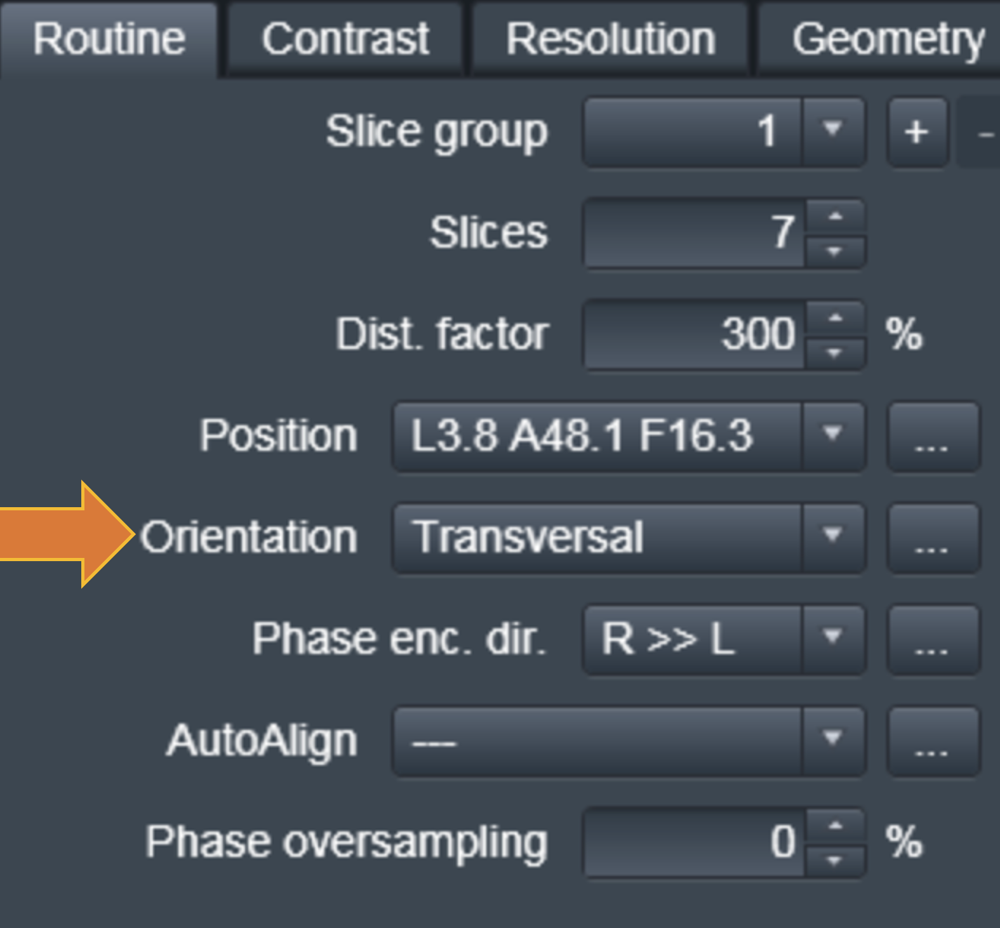 
**Figure 2.** Location of the “Orientation” field

## AC-PC plus/minus an angle
Here AC-PC refers to anterior commissure - posterior commissure, i.e. the two white matter tracts connecting the two hemispheres at the anterior and posterior ends of the third ventricle. The line connecting the two commissures is a key anatomical plane in neuroimaging and neuroanatomy.

The figures below illustrate how to find the AC and PC on a high-resolution anatomical image, and in post-mortem.

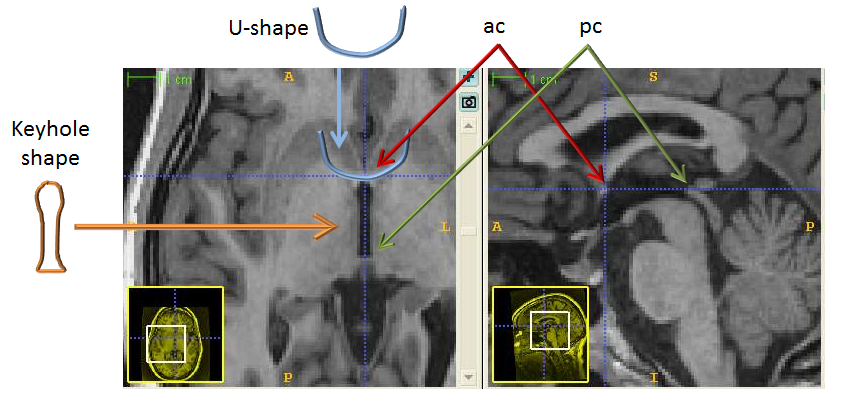 
**Figure 3.** Location of anatomical landmarks and identification of the anterior commissure (AC) and posterior commissure (PC). [Source: https://sabre.brainlab.ca/docs/processing/stage3.html]

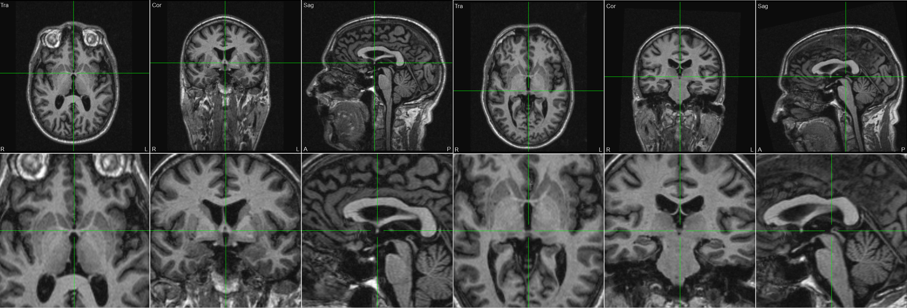 
**Figure 4.** Location of the anterior (left) and posterior (right) commissures on a T1 weighted structural scan. [Source: http://wiki.besa.de/index.php?title=Marking_AC-PC_Points_in_BESA_MRI]

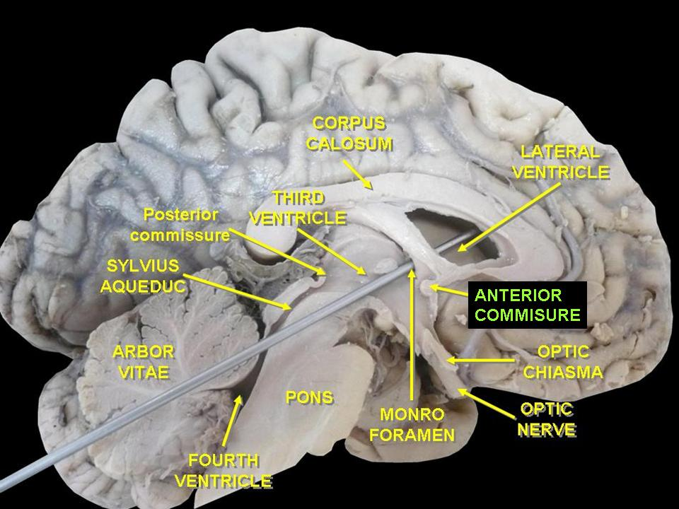 
**Figure 5.** The anterior and posterior commissures and other important anatomical landmarks on a post-mortem brain, sliced along the sagittal midline [source: https://en.wikipedia.org/wiki/Anterior_commissure]

However, in everyday practice, scans are not planned on a high-resolution 3D anatomical scan, but on a localizer. Identifying the AC-PC line might not be possible, thus the Splenium-Genu or Splenium-Rostrum line might be used instead. This line connects the most inferior-posterior portion of the corpus callosum to the most inferior-anterior portion (in plain english, the bottom back bit with the bottom front bit), and is parallel to the AC-PC line within a few degrees. See the figure below for the reference line.

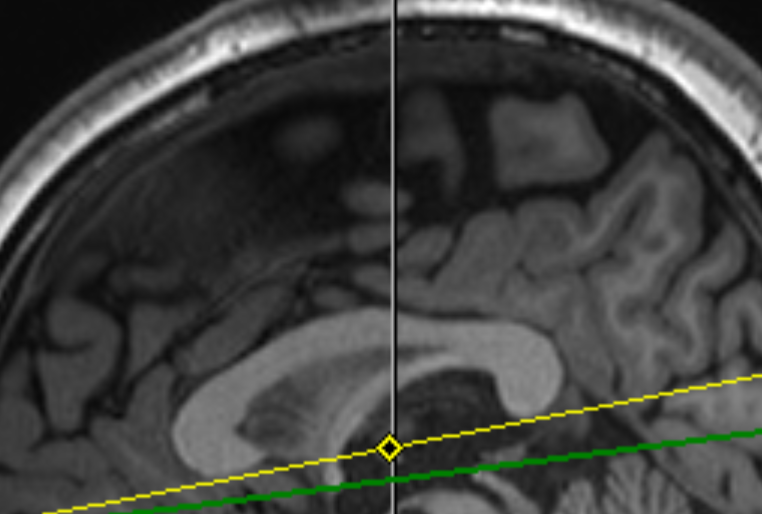 
**Figure 6.** The Splenium-Rostrum line (yellow) on a T1 weighted MRI scan

**Procedure:** 
Drag the FOV and align it with the AC-PC line or with the bottom of the corpus callosum. Note down the rotation in the Sequence Card, and under Routine/Orientation field. Compute the desired angle (that is, subtract the “angle” value in “AC-PC plus minus angle” from the current value).

Click on the three dots, and enter the desired rotational angle. Finally, position the FOV, without rotating it, such that it covers the desired anatomy. Please see the figure below for a graphical step-by-step guide. Note that for the sake of clarity, the guide uses the top slice (the top of the yellow box) to position the FOV, but the middle of the FOV is equally sufficient.

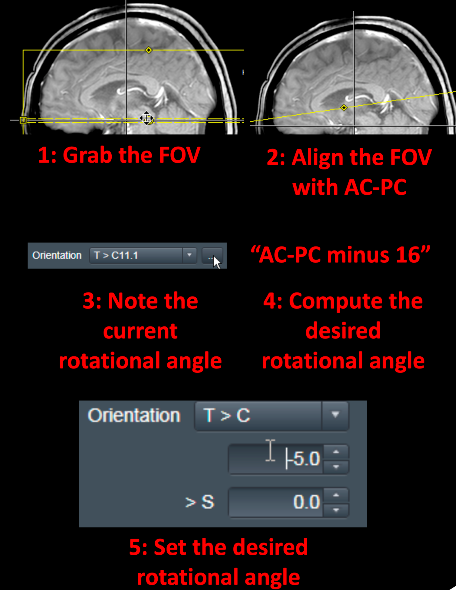 
**Figure 7.** How to set a desired rotational angle with regards to AC-PC

## True AC-PC
True AC-PC indicates that these scans have to be aligned using the actual commissures, without using the corpus callosum as a shortcut. The procedure to align and rotate the FOV remains the same, but the anatomical landmarks with which the FOV has to be aligned have to be AC-PC. Any such scan will be preceded by a high-resolution anatomical scan to aid positioning.

## Double oblique FOV
While rare, some protocols use double oblique FOV, that is, the FOV is rotated along two axes. In such cases, enter the second desired rotational angle in the same field as on Figure 7, step 5.

# <a name="tablepos">Table positioning</a>

**Description:** 
Table positioning refers to the positioning of the patient table, as it refers to the imaging FOV. At the beginning of a scan, a laser is used to position the isocentre, and the table is then pushed into the magnet. Once the table is at Isocentre, the position marked with the laser should be at the isocentre of the magnet.
As such, the starting table position of a scanning session is, by definition, H0, that is the table is at isocentre (the offset is 0).
The scanner supports three positioning modes, `FIX`, `ISO`, and `REF`

`FIX` mode means that the table position is fixed to the currently entered value. In this case, the table will not move, even if the center of the FOV of a scan is moved along the head-foot axis.
By default, the table position that is being fixed is the position of the last scan.

`ISO` mode means that the table will be moved, such that the centre (in the head-foot direction) of the FOV of the scan being planned will be at the isocentre.
If the centre of the FOV is moved towards the foot, the table will move into the bore (in order to push the new, lower position into the isocentre). If the centre of the FOV is moved towards the top of the head, the table will move out of the bore, in order to push the new, higher position into the isocentre.
The new position will be reflected in the letter and number next to the positioning mode, indicating movement towards the head (H) or foot (F) direction, in millimeters.
Note that ISO mode is required to plan on distortion corrected images.

`REF` mode is less often used. The following description of its use-case and impact comes via John Krisch of the A.A. Martinos Centre (a scout is the same as a localizer):
REF uses the table position of whatever graphic segment is clicked on/active. If only one scout is performed with one table position, it will act exactly the same as a protocol with all sequences set to Fix H-0. If a second scout was run at iso at a different position such as the neck, now the sequence on ref could use either table position, whichever scout is selected. The slab will move depending on which loc is loaded into the graphic segment. This actually makes sense and is helpful, because a user could landmark the neck and scan an entire spine, run a localizer on iso positioned on the head, and then with all of the brain sequences to be run set to reference they can use the same position of the head localizer and all match for image fusion, spectroscopy, etc.

# <a name="pe_rev">Reversing the Phase Encoding Direction</a>
**Description and use case:**
For scans acquired using EPI sequences (such as fMRI and diffusion MRI), it is important to acquire at least some volumes with “opposite” phase encoding direction. These can then be used to correct for the distortions caused by B0 inhomogeneities. Typically, this manifest in the protocol in the following way:

A long series of EPI scans (a full fMRI task scan or a full diffusion MRI scan with all diffusion directions) is acquired using one phase-encoding direction, for example, AP, or anterior-posterior; and following that, a shorter scan of a few volumes using the reversed phase encoding direction, in this case PA, or posterior-anterior. This will be reflected in their names, like my_awesome_fMRI_scan and my_awesome_fMRI_scan_pa, and the protocol comments should mention needing to reverse the phase encoding direction.

This is typically done after Copying the Centre of Slices and Sat Regions (that is, the FOV alignment) from my_awesome_fMR_scan to my_awesome_fMRI_scan_pa, and then opening the sequence card, navigating to Routine/Phase. Enc. Dir., clicking on the three dots next to the value, and entering an Inplane Rotation of -180 degrees. If the original rotation is negative, then add 180 degrees. If the original rotation is positive, subtract 180 degrees. After this, the value of Phase. Enc. Dir. should change from `A>>P` to `P>>A`.

See the Figure below for a graphical guide.

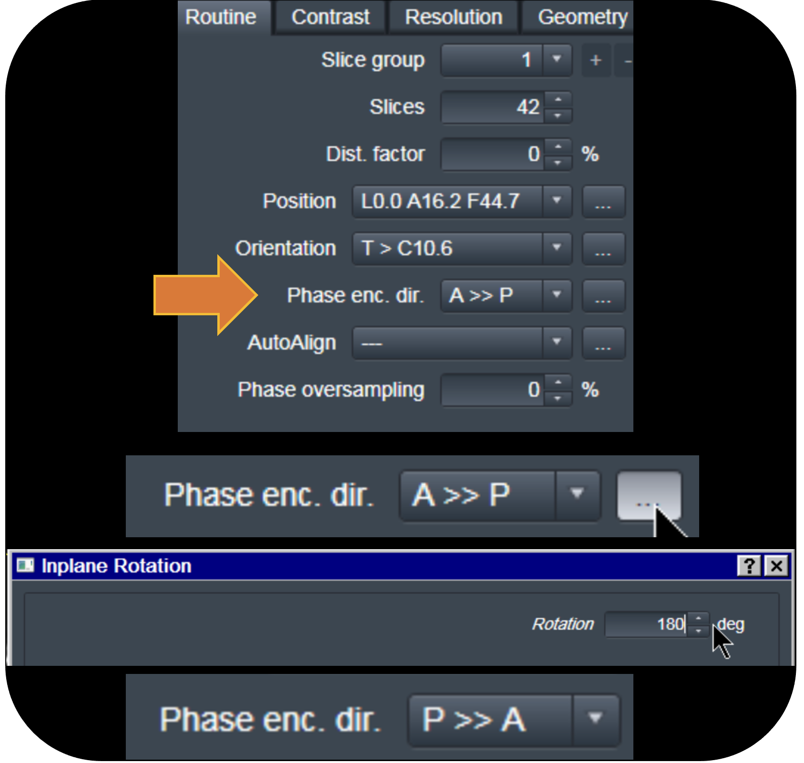 
**Figure 8.** How to reverse the phase-encoding direction. Note the change from A>>P (anterior-to-posterior direction) to its reverse, P>>A (posterior-to-anterior direction)

# <a name="mpr">Multiplanar reconstruction for spectroscopy planning</a>
Description and use case:
Spectroscopy scans are planned on a high-resolution anatomical scan that has been re-sliced along the “missing” two anatomical planes. Typically, these are 3D T1 weighted scans acquired using an MPRAGE sequence and Distortion Correction. Thus, for a scan acquired using Sagittal orientation, the Transversal and Coronal slicings must be reconstructed.

Procedure:
The anatomical scan (in this example acquired sagitally) must be loaded into the 3D tab of the Scanner Console. Then, using the “Parallel Ranges” button, one of the slicing presets has to be selected and the slicing orientation set. This slicing must be saved using the “Save As” button, and the procedure repeated for a coronal slicing. Then, the sagittal, transversal and coronal views can be loaded into the MRI console, and enable a precise positioning of the spectroscopy voxels and saturation bands

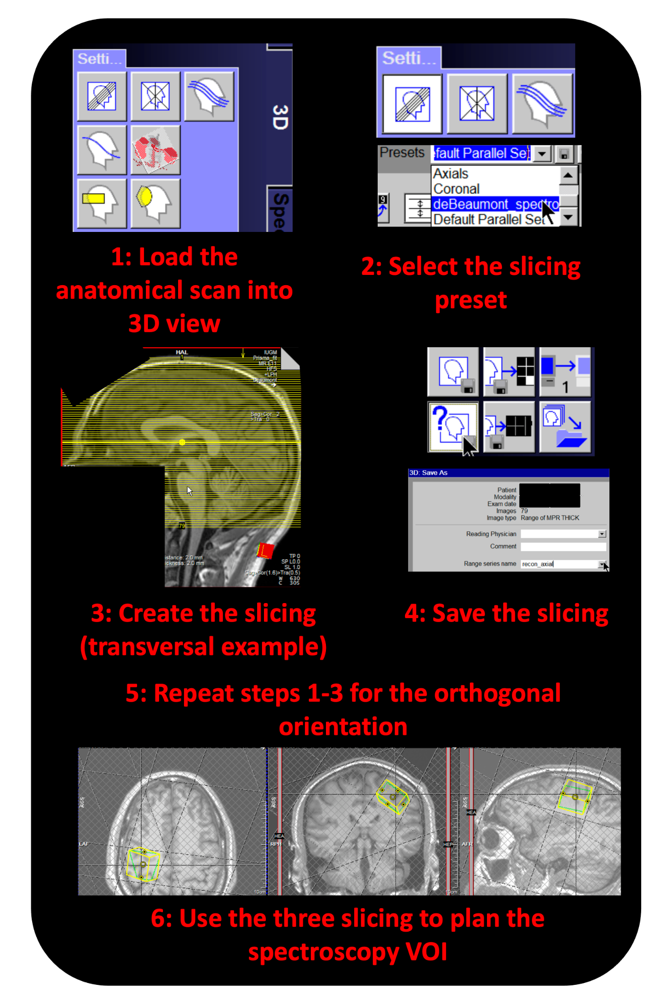 
**Figure 9.** Slicing and planning for a spectroscopy VOI

# <a name="advshim">Advanced shimming</a>

### Description and use case:
Some scans, typically scans involving spinal or heart imaging, require a more precisely shimmed B0 field than what can be achieved by only adjusting the shim box. In these cases, an iterative shim, or advanced shim, has to be performed.

### Procedure:
The scan in question needs to be open, and the FOV and Adjustment Volume (the fellow FOV box and the green Adjustment Volume box, respectively) positioned correctly.

Next, the Options→Adjustments→3DShim tab has to be opened. Then, start a measurement by clicking “Measure”. Wait for the measurement to stop. Once the measurement has stopped, click the “Calculate” button. This will fill up the top of the 3Dshim tab with shim values. Then, hit the “Apply” button immediately above Calculate. This will move the calculated shim values from the “Temporary” column to the “System” column. Repeat this procedure two more times.

Now, hit the “Apply” button on the top, above “Measure”. This will move the number in the Fieldmap (temp) field into the Fieldmap (sys) field, replacing the question mark.

Next, close the Adjustment window, and acquire the scan.

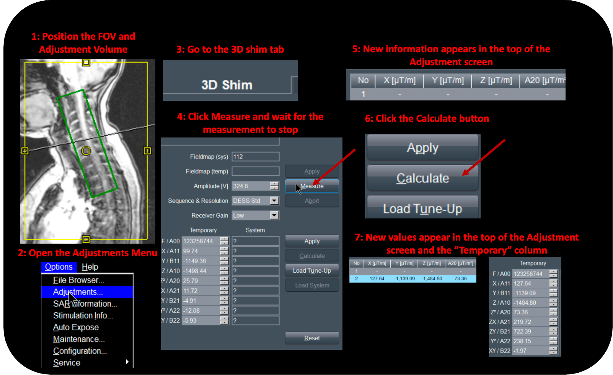 
**Figure 10.** Part 1 of advanced shimming

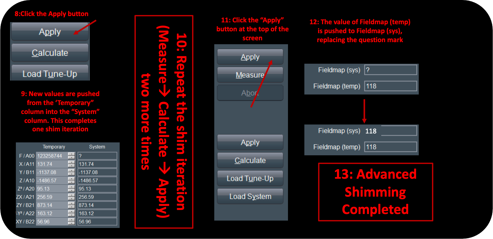 
**Figure 11.** Part 2 of advanced shimming

## <a name="coupled-graphics">Using Coupled Graphics (useful for spectroscopy planning)</a>

### Description and use case:
The “Coupled Graphics” option allows GUI elements associated with planning scans to be moved as a group. For example, in a multi-slice acquisition with many slice groups, they can be moved together, preserving their relative position to each other while changing their position respective to the anatomy.

However, the most common use case for this is in spectroscopy, if saturation bands have to be adjusted.

### Procedure:
1. Open the Exam Menu
2. Open the scan you wish to edit
3. Right click on one of the three views and select “Coupled Graphics ON”. A checkmark should now appear next to the option
4. Grab the VOI of the spectroscopy scan, and reposition it. All the saturation bands should now be moved with it.

## <a name="pmu-recording">Recording PMU data</a>

# Opening a terminal

### Description:
Some advanced protocols, and some research projects may require commands being run in the terminal.

### Procedure:
1. Hit `Ctrl` + `Esc` on the keyboard to open up the Windows Start Menu and click on `Run`
2. Enter “cmd” to start a command line interface

# Mounting a network drive

Requires Advanced User

### Description and use case:
Mounting networked drives allow for exporting data (DICOM files, spectroscopy files, TWIX files, etc) from the scanner directly onto the networked drive. Commonly, this is used to export spectroscopy data.

### Procedure:
1. Hit `Ctrl` + `Esc` to open up the Start Menu. Click on Computer to open a Windows Explorer, and go to “Mount Network Drive”. The drive is usually “Y”, and the path of the mounted folder is an IP address followed by the folder path. This path should be provided in the operator SOP for any protocol.
2. Tick on “Connect Using Different Credentials”, and use the Username and Password corresponding to the protocol.

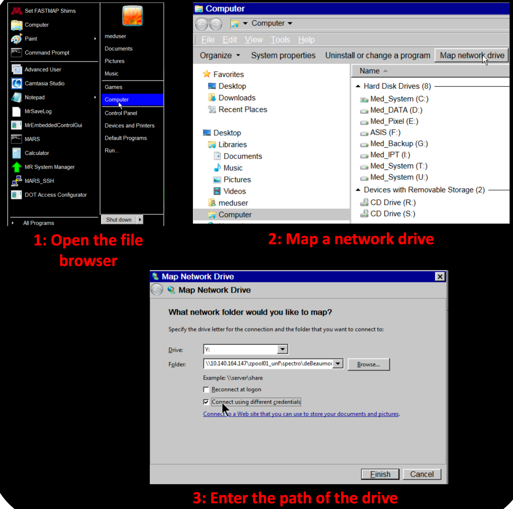 
**Figure 14.** Mounting network drive

# Mounting an external drive with direct DICOM export

### Description and use case:
Some researchers (typically Neuropoly) may want to mount a laptop as an external drive of the scanner, to enable direct export of DICOM data.

Procedure:
On the laptop (assuming Mac OS):
1. Connect the laptop to the VLAN SIEMENS 08 ethernet plug.
2. Create a new folder called SYNGO_TRANSFER
3. In System Preferences/Network, ensure that Configure IPV4 is “Using DHCP”.
4. In System Preferences/Network, select the new connection and note down the IP address. In the figure below, this is 10.30.16.100.

5. 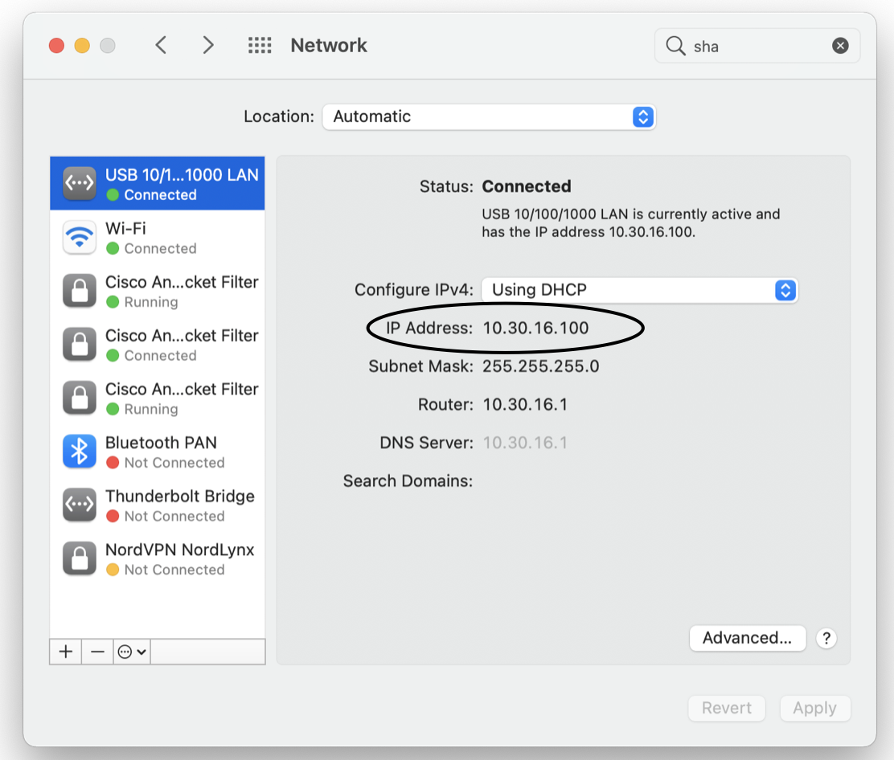 

6. In System Preferences/Sharing, enable File Sharing to the SYNGO_TRANSFER folder, and make sure that the user (Alexandru Foias in this example) has Read and Write access to the folder

7. 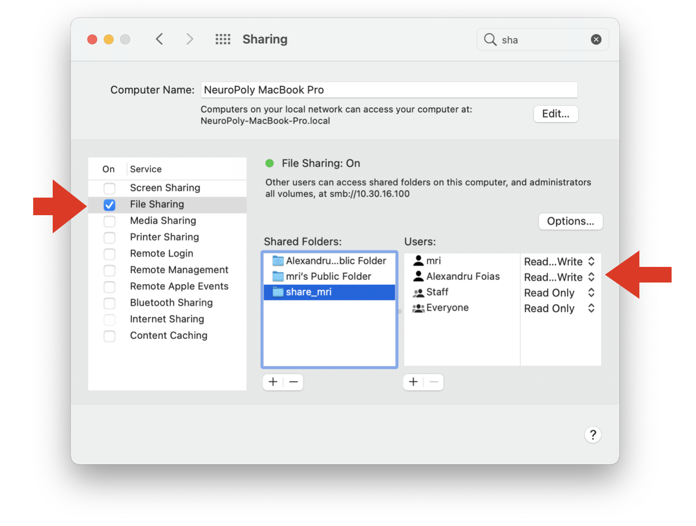 

8. In System Preferences/Sharing, click on “Options” and turn on SMB sharing for the user.

9. 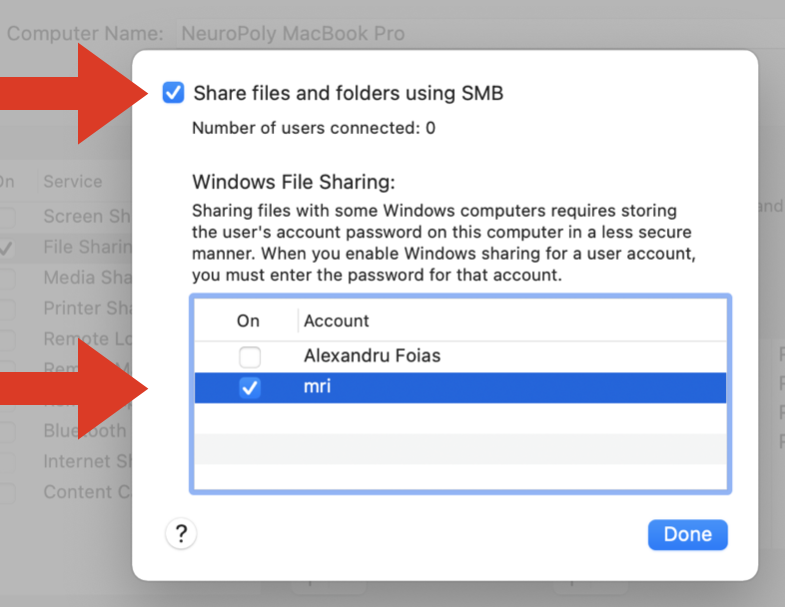 

**<u>On the scanner console, before acquiring the protocol:</u>**
1. Turn on Advanced User
2. Map a Network Drive, using the IP address of the laptop (10.30.16.100 as above) and the SYNGO_TRANSFER folder: \\10.30.16.100\SYNGO_TRANSFER
3. Check “Connect Using Different Credentials” and enter the password and username corresponding to the laptop. Note that the username should be preceded by a backslash: “\”
4. Open a terminal
5. Change the directory “cd %ICE_CONFIG%”
6. In this directory, run the following command: “xbuilder IceConfig.evp”
7. In the XBuilder, change the following parameters: ICE/CONFIG/OnlineSendConfiguration/OnlineSendIma → set to True (tick ON)
ICE/CONFIG/OnlineSendConfiguration/OnlineTargetHostName → set to “localhost”
ICE/CONFIG/OnlineSendConfiguration/OnlineTargetPort → set to “-1”
ICE/CONFIG/OnlineSendConfiguration/OnlineTargetPath → set to  “Z:\SYNGO_TRANSFER”
8. Save the file by clicking on the Save icon
9. Acquire the protocol

**<u>On the scanner console, after acquiring the protocol:</u>**
10. Repeat steps 4-7, undoing the changes detailed in step 7
11. Open the File Browser, right-click on the mounted drive, and “Disconnect Mapped Drive”

# Exporting Spectroscopy Data
### Requires Advanced User
### Description:
Usually, spectroscopy data is exported directly to a mounted network drive specific to the study, into a folder specific to the scan session.

### Procedure:
1. Mount the spectroscopy drive as a network drive.
2. Acquire the spectroscopy data
3. In the Spectroscopy Card, select the relevant spectroscopy raw data and, go to Options/Export raw data, and select the appropriate folder on the mounted drive

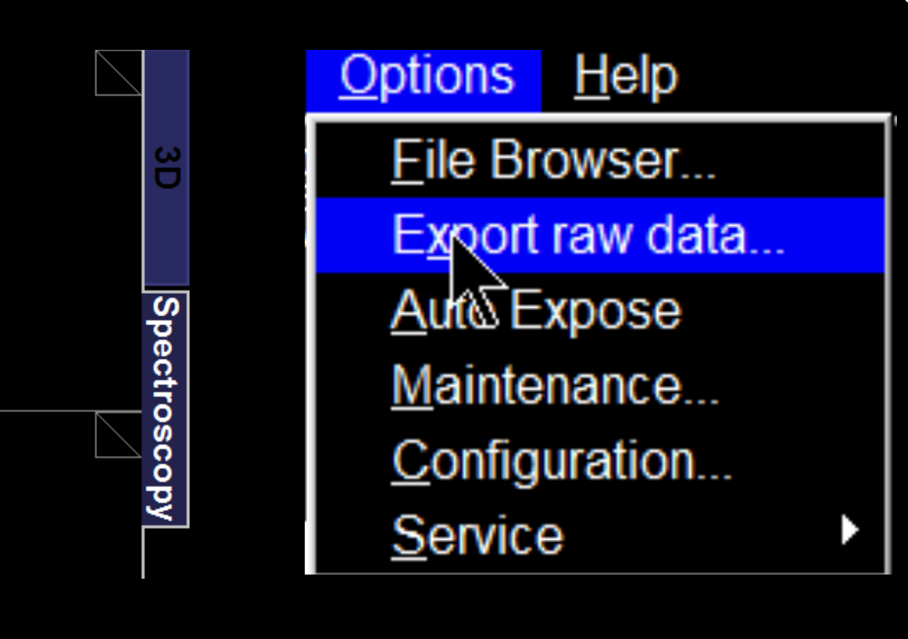 
**Figure 15.** Exporting spectroscopy raw data

# Exporting TWIX Data

### Requires Advanced User

### Description:
TWIX is the raw k-space data of a scan, with a data size at least an order of magnitude greater than that of the resulting MRI images. At UNF, TWIX data is typically exported for spectroscopy studies.

### Procedure:
1. Mount the spectroscopy (or appropriate) drive as a network drive.
2. Acquire the spectroscopy (or other) data
3. Open a terminal and run the following command “twix”
4. In the TWIX window, select the file that should be exported
5. Right-click on the file and select “Copy total raid file” and select the folder you wish to export it to. Note that since TWIX files are easily several GB in size, exporting will take a few minutes. Several TWIX files can be set to be exported at the same time.

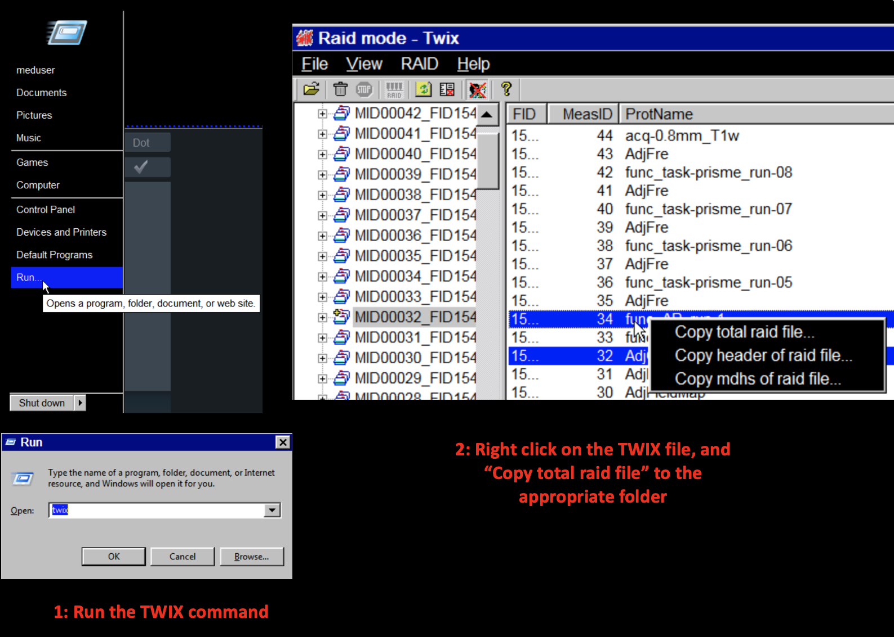 
**Figure 16.** Exporting TWIX data

# Retrospective Reconstruction (Retro Recon)

# Retrospective Reconstruction for Multiband Sequences

### Installation

### Procedure
1. Hit `Ctrl` + `Esc` and select **Run**
2. Enter `ideacmdtool` in the dialog box
3. Type `1`, `Enter`, `2`, `Enter`
4. Type `9`, the, `Enter`
5. Type in desired name for data file the `Enter`. The recording will start.
7. Type `10`, then `Enter` to stop acquisition.
8. Type `q`, then `Enter` 3 times to close the recording application
9. The results are saved in `C:\ProgramData\Siemens\Numaris\log`. Transfer data following steps outlined at:

# <a name="scanner-hang">What to do if the scanner hangs</a>

### Description and use case:
Sometimes, sequences might cause the scanner to “hang”. New sequences can not be set up or acquired, parts of the Syngo interface might freeze, etc. There are a few steps, in order of severity, that can be done to deal with such a situation.

It is recommended that at most two of the Restart/Reboot steps are performed before the scanner is rebooted.

### Restarting the Image Reconstruction software
1. Go to System/Control
2. Open the Meas & Recon tab
3. Click on Restart Software
4. Duration: approximately 3 minutes
5. The current patient information is preserved

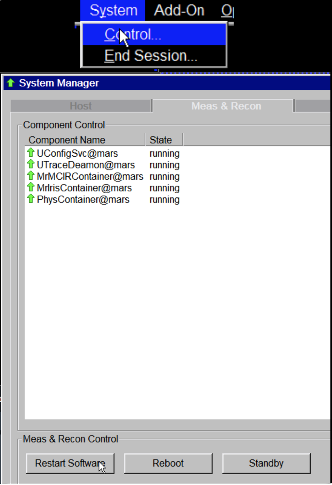 

### Rebooting the Image Reconstruction software
1. Go to System/Control
2. Open the Meas & Recon tab
3. Click on Reboot
4. Duration: approximately 5 minutes
5. <u>The current patient information is preserved</u>

### Restarting the Syngo Scanner Console
1. Go to System/Control
2. Open the Host tab
3. Click on Restart syngo MR
4. A confirmation window will pop up, click Yes
5. The scanner console will now restart
6. Duration: approximately 5+ minutes
7. The current patient information is NOT preserved, and the patient will have to be re-registered, a Localizer rerun, and the scan replanned

### Rebooting the Host Computer
1. Go to System/Control
2. Open the Host tab
3. Click on Reboot
4. A confirmation window will pop up, click Yes
5. The scanner console and the Host PC will now reboot
6. Duration: approximately 8 minutes
7. The current patient information is NOT preserved, and the patient will have to be re-registered, a Localizer rerun, and the scan replanned
8. DO NOT manually reboot the Host PC under any circumstances (because it usually solves nothing and wastes time)

### Restarting the scanner - Last Resort if UI control is still present
1. Go to System/End Session
2. Open the Host tab
3. Click on Restart System
4. A confirmation window will pop up, click Yes
5. The scanner will now shut down and restart
6. Duration: approximately 10+ minutes
7. The current patient information is NOT preserved, and the patient will have to be re-registered, a Localizer rerun, and the scan replanned

### Full power cycle of the scanner - Last Resort if UI control is lost
1. Use if and only If the UI of the scanner is fully unresponsive
2. Remove the bed from the scanner, and the patient from the table
3. Push the “System Off” button on the Siemens wall-mounted control panel (DO NOT, UNDER ANY CIRCUMSTANCES, TOUCH THE QUENCH BUTTON)
4. Wait 10 seconds
5. Push the “System On” button on the Siemens wall-mounted control panel
